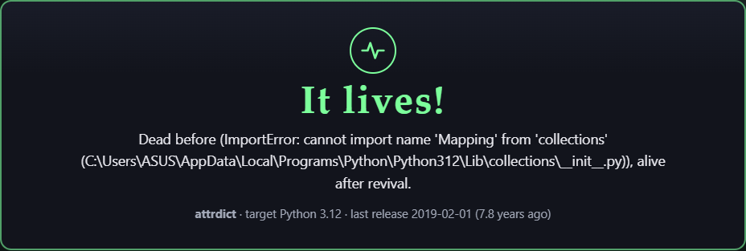
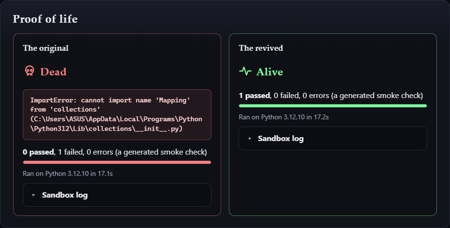
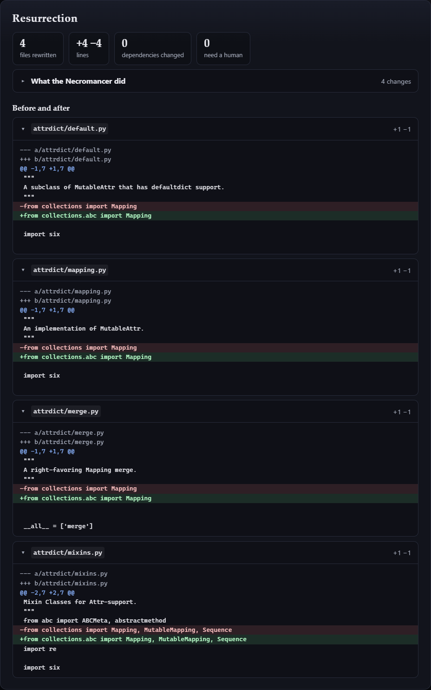

# Crypt Keeper

> _Finds out why an old Python package died, fixes what it safely can, and shows the proof._

Crypt Keeper digs up an abandoned Python package, finds out why it no longer works on modern
Python, rewrites what it safely can, and then **runs the result** to show whether it came back.

**What to expect.** Crypt Keeper is a diagnosis-and-proof tool first, not a reliable reviver. On old packages
it had never seen, it brought back **5 of 14** that were dead on Python 3.12 (36%, 95% interval 16% to 61%; the
previous version brought back 3 of the same 14), and its static autopsy named the cause for **10 of 19** on an
earlier list. The packages that do come back are single-cause failures, such as a standard-library
name that moved. When it cannot fix something it says so, with the exact error. The measured results are
[below](#how-often-does-it-work).

Built for **Kiroween 2026**, category **Frankenstein**.

## What it does

1. **Exhume.** Fetches a package from PyPI (or a GitHub repository): its source, release dates,
   and dependencies. Older releases have no dependency list on PyPI, so it reads the sdist's own
   packaging files.
2. **Autopsy.** The Coroner (pure Python, no network) reports the cause of death: abandonment,
   Python-support gap, pinned or yanked dependencies, APIs removed from the standard library
   (found by parsing the code, with the removal version of each), and Python 2 syntax.
3. **Resurrect.** The Necromancer converts Python 2 source in memory when a runtime file does not parse
   (disable with `CRYPT_KEEPER_CONVERT_PYTHON2=0`), declares imports from a fixed table, and caps dependencies
   below the release that removed a name the code uses. It rewrites only drop-in replacements, as precise text edits that
   keep comments and formatting: `collections.Mapping` to `collections.abc.Mapping`, removed
   `unittest` aliases, same-module renames, exact pins to lower bounds, and raised minimums for
   21 compiled packages. Everything it cannot fix safely is listed as a manual item.
4. **Proof of life.** Imports the original and the revived package in throwaway virtualenvs and
   runs the package's own tests (or a generated smoke check). The verdict compares the two.

5. **Take it with you.** One button downloads a zip: `patch.diff` (applies with `git apply`, checked
   against the real original source), the revived `.py` files, the new requirements, and a plain
   report. Nothing in it has been run, and the report says so.

Real runs on Python 3.12.10 (checked on the target Python, not a stand-in). **These four are the packages
I developed against, so they flatter the tool.** The honest rate on packages it had never seen is below.

| Package (last release) | Original | Revived | Time |
|---|---|---|---|
| `attrdict` (2019) | dead: `cannot import name 'Mapping' from 'collections'` | alive | 13 s |
| `hyper` (2016) | dead: `cannot import name 'Iterable' from 'collections'`; 4 tests pass, 13 error | alive; 95 tests pass, 8 fail, 5 error | 29 s |
| `unittest2` (2015) | dead: `no attribute 'MutableMapping'`; 14 test errors | alive; 6 tests pass, 1 fail, 21 error | 19 s |
| `flask-restplus` (2019) | dead: `cannot import name 'cached_property' from 'werkzeug'` | still dead: with `werkzeug` capped below 1.0, the old Flask it pulls in needs `markupsafe.soft_unicode`, and no MarkupSafe that has it installs on 3.12 | 20 s |







The first three are single-cause failures: a standard-library name that moved. The last one
depends on a function removed from another library. Capping that library is not enough, because of what the cap pulls
in, and the verdict says `still dead` with a suggested next step. Packages that already worked (`Pyro4`, `pathlib2`)
read `already alive`. The public host gives the same four verdicts: its reviewed dependency list includes what revival
adds (`setuptools` and `werkzeug` for `flask-restplus`).

### How often does it work?

**Latest measurement (clean).** After adding Python 2 conversion, import declaration and dependency caps, I wrote a
new list of 63 candidates (`benchmark/packages-fifth.txt`) once the code was final and never changed it after running.
On Python 3.12, 14 were dead. The previous version (commit 154ff82, built as its own image) revived 3 (21%, 95%
interval 8% to 48%). The final code revived 5 (36%, 16% to 61%). The intervals overlap, so this is an
improvement I can show, not one I can prove at this sample size. The new gains were `pyttsx` (Python 2 conversion) and
`soundcloud` (a declared `six`); `pycrypto` also got further. On the two lists I tuned against, the same change went
from 1 to 6 of 20 and from 4 to 6 of 16, and those numbers flatter it. Known weaknesses: `musicbrainzngs` passes
fewer tests after revival (78 to 66) and `Cheetah` gained a `Django` dependency from an optional module.

**Earlier measurement (previous version, commit 154ff82).** I ran it on lists of old PyPI packages it had never seen (a written rule picks them: last release before 2021,
an sdist exists; the lists are in `benchmark/`). The clean measurement, on a list of 39 that nothing was tuned on, on
Python 3.12:

- **20 were dead. Crypt Keeper brought back 1 of them (5%, 95% confidence interval 1% to 24%).**
- 18 were alive anyway, and 1 was only a placeholder with no code of its own.
- Of the 19 that stayed dead, 8 are Python 2 code, 5 are broken by a newer dependency, 4 import something they never
  declare, and 2 have a dependency that cannot be installed from a wheel.

An earlier list gave the same rate (1 of 21). On the 5 dead packages used while building it, 3 came back, because the
code was tuned to those. Between lists I added three changes (declare `setuptools`, rewrite `inspect.getargspec`
where it is provably safe, call placeholders "nothing to run"); on the list they were built from they revived 3 more
packages, and on a list nobody had read they changed 2 of 39 outcomes, one of them a revival. The benchmark also
found two bugs in the exhumer, now fixed. Every run, package, failure and caveat is in
[`docs/BENCHMARK.md`](docs/BENCHMARK.md).

### Does the autopsy name the cause?

For the 19 dead packages in that clean list, I checked whether the static autopsy (nothing is executed) named
why each one is dead, against my hand reading of each recorded failure. The full table is in
[`docs/DIAGNOSIS.md`](docs/DIAGNOSIS.md); `python scripts/diagnosis_check.py run` reproduces it.

- **10 of 19 named.** All 8 Python 2 packages (it reports code that does not parse as Python 3), and the 2
  packages whose dependency could not be installed (it flagged that dependency as old or hard-pinned; it did not
  predict the install would fail).
- **0 of 9 named** for the two causes it has no rules for: a dependency that removed a name the package uses (5),
  and an import the package never declares (4). Running the package reveals both, because the proof-of-life error
  names the exact failing import, but the autopsy alone does not predict them.
- For `minimongo` and `Pylons` the autopsy also found Python 2 syntax that my hand reading had missed, so naming the
  first failure would not have been enough to revive them.

The cause labels are mine and I wrote the matching rule after reading the autopsy output, so treat the numbers as
indicative, not as a clean measurement.

### The Undertaker

`undertaker/` re-triages a watchlist of abandoned packages and reports what changed since the last run: a package
that became revivable, or published a new release. It is static (it runs no package code) and is meant to run
nightly as a Kiro Crew job. The script and its tests are done; **the Crew job itself is untested**.
See [`undertaker/README.md`](undertaker/README.md).

## Run it

```powershell
cd backend
python -m venv .venv
.venv\Scripts\activate
pip install -r requirements.txt
python -m uvicorn api.main:app --port 8000
```

Open <http://127.0.0.1:8000>. The API serves the UI, so there is nothing else to start.
Interactive API docs are at `/docs`. Run the tests with `python -m pytest` from `backend/`.

**Install the target Python.** Proof of life runs on the target version (default 3.12) only if
that interpreter is installed. If it is not, the run falls back to the current Python and the
verdict reads `unverified`, because a package that imports on 3.11 can still fail on 3.12.

## Safety

Proof of life **executes the package's own code** as your user, with network access. It uses a
fresh virtualenv, wheel-only installs, a scrubbed environment, timeouts, and process-tree
kills, but it is **not a security boundary**. Only revive packages you would be willing to
import. Set `CRYPT_KEEPER_PROOF_OF_LIFE=off` to disable it. A public deployment needs a
container or VM around it.

A dependency with no wheel for the target Python is not installed, because building it from source runs its own
`setup.py`. On your own machine you can allow that with `CRYPT_KEEPER_ALLOW_SOURCE_BUILDS=1`: the log then lists
which dependencies were built. It is ignored on a public host (`CRYPT_KEEPER_PUBLIC`), whatever it is set to.

The API rejects cross-origin and non-JSON POSTs and unknown Host headers, so another website
cannot make your browser send code to a local Crypt Keeper. Configure with
`CRYPT_KEEPER_ALLOWED_ORIGINS` and `CRYPT_KEEPER_ALLOWED_HOSTS`.

**Public deployment.** The included `Dockerfile` runs proof of life only for a curated list of
packages (`CRYPT_KEEPER_PROOF_ALLOWLIST`); everything else gets the autopsy and revival without
being executed. See [`docs/DEPLOY.md`](docs/DEPLOY.md) for Cloud Run steps, what was tested, and
what was not.

## Layout

```
backend/
  coroner/       autopsy: liveness, dependencies, removed APIs (pure)
  necromancer/   revival: dependency bumping, source rewriting, diffs (pure)
  proof/         what to import, test and smoke-call; the verdict (pure)
  api/           FastAPI app, exhumer (network), sandbox (subprocess)
frontend/        the UI: plain HTML, CSS and JavaScript, no dependencies
mcp-server/      MCP tools: get_pypi_metadata, get_repo_tree
undertaker/      the nightly watchlist triage (a Kiro Crew job runs it)
benchmark/       the candidate lists and raw results of the success-rate benchmark
scripts/         smoke test, benchmark runner, dependency review
docs/            how Kiro was used, the benchmark, deployment
.kiro/           specs, steering and hooks that drove the build
```

## Limits

- Only `.py` files are exhumed. Packages that need data files or C extensions at import time can
  fail for reasons unrelated to their age.
- A source tree over 1,500 files is truncated and flagged as such in the report.
- GitHub exhumation reads at most 200 files and `requirements.txt` only.
- Large packages are slow: `boto` takes about 3 minutes because its test suite is large.
- Python 2 conversion uses `lib2to3` and only runs when a runtime file does not parse. It fixes syntax, not
  behavior (text versus bytes, integer division), so converted code can still fail or lose tests. The dependency
  caps and import table cover only the cases I verified on Python 3.12; other breakages are reported, not fixed.
- `inspect.getargspec` is rewritten only where the replacement provably means the same; other uses stay for a person.
- Loosening a dependency's version cap can break a package that worked (`pyelasticsearch` in the benchmark).
  When that happens, the revived code runs once more with the package's own dependency list; if that works, the
  revision keeps the original list and says so. If it does not, the verdict reads `regressed`.
- When a revived package still fails, the verdict shows a cause and a next step read from the error message. It is a
  reading of the text, so it can be wrong; it names the rule that matched.
- The downloaded zip has only the `.py` files, not a complete package. Apply `patch.diff` to your own checkout.

## How Kiro was used

See [`docs/KIRO_USAGE.md`](docs/KIRO_USAGE.md) and [`.kiro/`](.kiro/).

## License

MIT. See [LICENSE](LICENSE).
